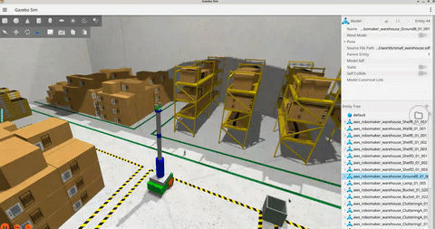
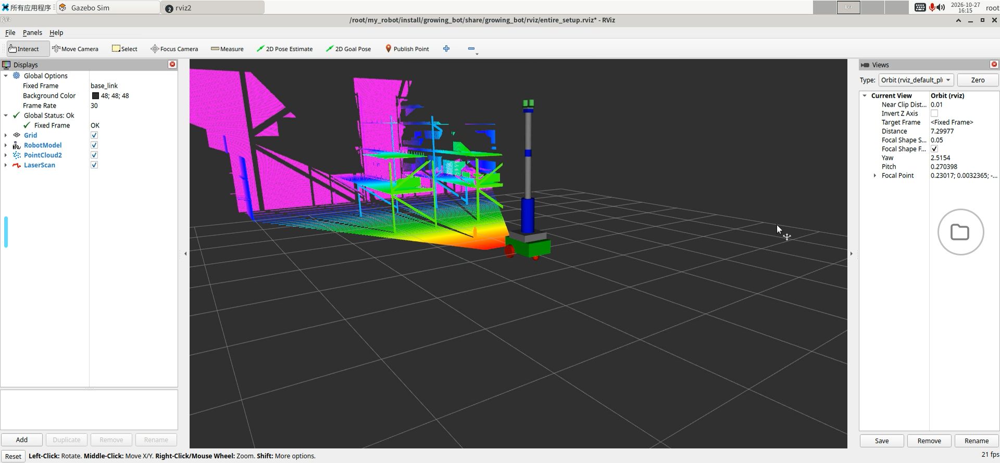

# Growing Bot: ROS 2 移动抓取机器人

这是一个基于 ROS 2 Jazzy 的移动机械臂仿真项目。机器人运行在 Gazebo Sim 中，使用差速底盘在仓库环境内导航，并通过 RGB-D 相机识别和定位塑料瓶，最后由机械臂和夹爪完成抓取。
项目的主要能力包括：

- Gazebo Sim 仿真：差速底盘、Kinect 深度相机、2D LiDAR、IMU、机械臂和夹爪。
- Nav2 导航：使用已有地图、AMCL 和 MPPI 控制器进行定位与导航。
- MoveIt 2 运动规划：规划机械臂和夹爪的关节轨迹，并通过 ros2_control 执行。
- YOLO 瓶子检测：从 RGB 图像中检测 `bottle`，输出目标像素位置。
- 三维定位：从点云读取目标深度，通过 TF2 将坐标转换到 `base_link`。
- 自动抓取状态机：目标不可达时先导航靠近，目标进入机械臂工作空间后执行抓取和仿真附着。

## 仿真演示



### RViz 视图



## 1. 技术路线
```text
Gazebo Sim
	├─ RGB 图像 ──> YOLO 瓶子检测 ──┐
	├─ PointCloud2 ────────────────┼─> 相机坐标 XYZ
	└─ TF2: kinect_camera -> base_link ┘
																			│
									  v
						 /growing_bot/bottle/position
									  │
									  v
						 pick_state_machine
						 ├─ 目标在工作空间内 -> MoveIt 抓取
						 └─ 目标不可达       -> Nav2 靠近后重新检测
```

抓取状态依次为：
`IDLE -> SEARCH_BOTTLE -> BOTTLE_FOUND -> MOVE_TO_BOTTLE -> GRASP -> ATTACH -> DONE`

其中 `MOVE_TO_BOTTLE` 不是固定执行步骤：只有在瓶子超出机械臂可达范围时才会触发，底盘到位后会重新检测，避免使用移动前的旧坐标。
## 2. 环境要求

- Ubuntu 24.04
- ROS 2 Jazzy
- Gazebo Harmonic / Gazebo Sim
- `colcon`、`rosdep`、Python 3
- YOLO 推理依赖：Ultralytics、OpenCV、`cv_bridge`

安装 Gazebo 和常用 ROS 依赖：
```bash
sudo apt update
sudo apt install \
	ros-jazzy-ros-gz-sim \
	ros-jazzy-ros-gz-bridge \
	ros-jazzy-ros-gz-interfaces \
	ros-jazzy-navigation2 \
	ros-jazzy-nav2-bringup \
	ros-jazzy-slam-toolbox \
	ros-jazzy-moveit
```

在工作区根目录执行依赖安装：

```bash
cd <workspace>
rosdep install --from-paths src --ignore-src -r -y
source /opt/ros/jazzy/setup.bash
```

安装 Python 检测依赖，并确保 YOLO 模型文件位于当前工作目录，或在启动时传入绝对路径：

```bash
python3 -m pip install ultralytics opencv-python
```

默认模型为 `yolo11n.pt`。首次运行 Ultralytics 可能会自动下载模型。
## 3. 编译

```bash
cd <workspace>
source /opt/ros/jazzy/setup.bash
colcon build --symlink-install
source install/setup.bash
```

只编译本项目相关包：

```bash
colcon build --symlink-install \
	--packages-select growing_bot growing_bot_moveit_config detector
```

## 4. 一键启动完整系统

推荐使用 `full.launch.py`。它会启动 Gazebo、机器人模型和传感器，等待 20 秒后启动 MoveIt、Nav2、YOLO 定位节点及抓取状态机：

```bash
source /opt/ros/jazzy/setup.bash
source install/setup.bash
ros2 launch detector full.launch.py
```

`full.launch.py` 默认使用仿真时间 `use_sim_time:=true`。如果需要指定 YOLO 模型，使用下面的分模块启动方式为 `pick.launch.py` 传入 `model_path`。如果只需要启动仿真而不启动完整抓取流程，可以使用：

```bash
ros2 launch growing_bot gz.launch.py \
	ros_control_enabled:=true
```

## 5. 分模块启动

需要逐项调试时，可在不同终端按以下顺序启动：

```bash
# 终端 1：Gazebo、机器人、传感器和 RViz
ros2 launch growing_bot gz.launch.py ros_control_enabled:=true

# 终端 2：MoveIt 机械臂规划
ros2 launch growing_bot_moveit_config move_group.launch.py use_sim_time:=true

# 终端 3：Nav2、地图服务器、AMCL 和 RViz
ros2 launch growing_bot nav2.launch.py use_sim_time:=true

# 终端 4：YOLO 定位和抓取状态机
ros2 launch detector pick.launch.py \
	use_sim_time:=true \
	model_path:=/absolute/path/to/yolo11n.pt
```

## 6. 关键接口

| 类型 | 名称 | 说明 |
| --- | --- | --- |
| 订阅 | `/growing_bot/rgb_camera` | RGB 图像输入 |
| 订阅 | `/growing_bot/kinect_camera/points` | 深度点云输入 |
| 发布 | `/growing_bot/bottle/position` | 瓶子在 `base_link` 下的 `PointStamped` 坐标 |
| 发布 | `/growing_bot/pick_state` | 抓取状态，消息类型为 `std_msgs/String` |
| Action | `follow_waypoints` | Nav2 底盘导航 |
| 发布 | `/growing_bot/bottle/attach` | Gazebo 中将瓶子附着到夹爪 |
| 发布 | `/growing_bot/bottle/detach` | 解除瓶子附着 |

查看检测坐标和抓取状态：

```bash
ros2 topic echo /growing_bot/bottle/position
ros2 topic echo /growing_bot/pick_state
```

查看输入是否正常：

```bash
ros2 topic hz /growing_bot/rgb_camera
ros2 topic hz /growing_bot/kinect_camera/points
ros2 run tf2_ros tf2_echo base_link kinect_camera
```

## 7. 建图与导航

启动 SLAM：

```bash
ros2 launch growing_bot mapping.launch.py
ros2 run teleop_twist_keyboard teleop_twist_keyboard \
	cmd_vel:=/growing_bot/cmd_vel
```

保存地图：

```bash
ros2 run nav2_map_server map_saver_cli -f growing_bot/config/map
```

本仓库已提供 `growing_bot/config/map.yaml` 和 `map.pgm`，默认导航启动文件会加载这份地图：

```bash
ros2 launch growing_bot nav2.launch.py use_sim_time:=true
```

## 8. 抓取参数

抓取状态机节点支持以下常用参数：

| 参数 | 默认值 | 作用 |
| --- | ---: | --- |
| `min_reach` | `0.25` | 机械臂最小水平可达距离（米） |
| `max_reach` | `0.65` | 机械臂最大水平可达距离（米） |
| `max_grasp_z` | `0.45` | 允许抓取的最大高度（米） |
| `nav_standoff` | `0.5` | 导航到瓶子前的目标距离（米） |
| `max_nav_attempts` | `2` | 最大导航尝试次数 |
| `grasp_z` | `0.12` | 抓取高度（米） |

示例：

```bash
ros2 run growing_bot pick_state_machine --ros-args \
	-p min_reach:=0.25 \
	-p max_reach:=0.65 \
	-p max_nav_attempts:=3
```

## 9. 目录结构

```text
growing_bot/                 机器人模型、Gazebo、Nav2 和 C++ 节点
	urdf/                       Xacro 机器人描述
	worlds/                     仿真世界
	config/                     Nav2、ros2_control 和地图配置
	launch/                     仿真、建图、导航启动文件
	src/pick_state_machine.cpp  移动抓取状态机
growing_bot_moveit_config/    MoveIt 规划组、控制器和运动学配置
detector/                     YOLO 检测与三维定位 Python 包
	detector/bottle_localizer.py
	launch/pick.launch.py
	launch/full.launch.py
```